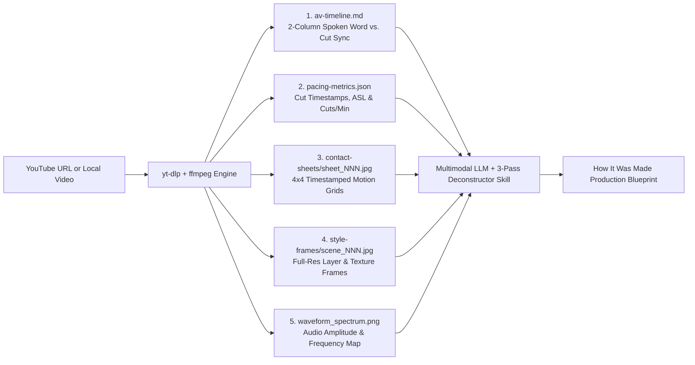

# video-deconstructor

**Reverse-engineer how any video is made — from Vox & Bloomberg explainers to 3D animations and motion graphics — using any multimodal AI model with zero paid video API keys.**

`video-deconstructor` is a cross-platform toolkit (**CLI + MCP Server + Agent Skill**) that bridges `yt-dlp` and `ffmpeg` with multimodal LLMs (**Gemini 4 Argon**, Claude Opus/Sonnet, GPT-6/4o) inside **GitHub Copilot, Claude Desktop, Claude Code, Cursor, and VS Code**.

---

## Why This Exists

Multimodal models inside coding agents cannot directly watch a YouTube URL or inspect raw `.mp4` streams—and sampling random static frames loses the **editorial rhythm, motion trajectories, camera rigs, and sound-design sync** that make channels like **Vox, Bloomberg Originals, Johnny Harris, Cleo Abram, Kurzgesagt, Fern, and 3Blue1Brown** work.

`video-deconstructor` converts any YouTube URL or local video into a structured **5-artifact deconstruction package** that lets an LLM see **motion, pacing, layer stacks, and audio-visual sync** in a few high-density images and markdown files:



---

## What It Can Analyze & Reverse-Engineer

| Dimension | What It Deconstructs | How It Captures It |
| :--- | :--- | :--- |
| **1. Narrative & Editorial Pacing** | Hook mechanics, chapter beats, Cuts Per Minute (CPM), Average Shot Length (ASL), B-roll vs. graphics ratio | `ffmpeg` scene-cut detection (`scdet`) + `pacing-metrics.json` |
| **2. Audio-Visual Script Sync** | Which exact spoken word triggers a visual cut, title card, or chart reveal | `av-timeline.md` (interleaves `.vtt`/`.srt` word timestamps with visual scene cuts) |
| **3. Sound Design & Music Cues** | Where SFX hits (whooshes, risers, paper foley, bass drops), music swells, and dramatic silences occur | `waveform_spectrum.png` (`showwavespic` + `showspectrumpic` aligned to video time) |
| **4. Visual Craft & Layer Stack** | Typography, color palettes, halftone/paper grain textures, drop shadows, blend modes, 3D shaders & lighting | `style-frames/scene_NNN.jpg` (uncompressed/high-res single frames at key cuts) |
| **5. Motion & Transition Mechanics** | After Effects 2.5D parallax rigs, GeoLayers map flyovers, kinetic typography, easing curves, match cuts, 3D camera paths | `contact-sheets/sheet_NNN.jpg` (`4x4` tiled grids at `1 FPS` overview or `6–15 FPS` motion zoom with millisecond `pts` timestamps) |
| **6. Recreation Blueprint** | Likely toolchain (After Effects, Blender, GeoLayers, Manim, Remotion, Resolve) + step-by-step layer & keyframe recipe | `skills/video-production-deconstructor/SKILL.md` (3-Pass Protocol) |

---

## Repository Layout

```text
video-deconstructor/
├── README.md                                 # Project overview & quickstart
├── LICENSE                                   # MIT License
├── plugin.json                               # Portable Agent Plugin manifest
├── docs/
│   ├── ARCHITECTURE.md                       # Deep dive into artifacts, ffmpeg filters & MCP schemas
│   └── IMPLEMENTATION-PLAN.md                # Phased implementation & verification roadmap
├── skills/
│   └── video-production-deconstructor/
│       └── SKILL.md                          # Portable 3-Pass Video Reverse-Engineering Skill
├── bin/
│   └── cli.mjs                               # Dual entrypoint: CLI + stdio MCP server
├── src/
│   ├── engine.mjs                            # Cross-platform yt-dlp + ffmpeg pipeline
│   ├── timeline.mjs                          # VTT/SRT + scene-cut 2-column A/V script builder
│   ├── metrics.mjs                           # Editorial pacing & shot-length statistics
│   └── mcp-server.mjs                        # MCP server exposing deconstruction tools
└── test/
    └── smoke.test.mjs                        # Cross-platform automated test suite
```

---

## Prerequisites (Windows, macOS, Linux)

`video-deconstructor` uses **`yt-dlp`** and **`ffmpeg`** on your system `PATH` (no paid API keys required):

- **Windows (`winget`):**
  ```powershell
  winget install yt-dlp.yt-dlp Gyan.FFmpeg
  ```
- **macOS (`brew`):**
  ```bash
  brew install yt-dlp ffmpeg
  ```
- **Linux (`apt`):**
  ```bash
  sudo apt update && sudo apt install -y yt-dlp ffmpeg
  ```

---

## Usage Modes

### 1. As an MCP Server (GitHub Copilot, Claude Desktop, Cursor, VS Code)

Add to your `mcp-config.json` / `claude_desktop_config.json`:

```json
{
  "mcpServers": {
    "video-deconstructor": {
      "type": "local",
      "command": "node",
      "args": ["/path/to/video-deconstructor/bin/cli.mjs", "mcp"],
      "tools": ["*"]
    }
  }
}
```

**Exposed MCP Tools:**
- `check_environment` — Verifies `yt-dlp`, `ffmpeg`, and `ffprobe` availability and reports OS install hints.
- `deconstruct_video_overview` — Runs Pass 1 & 2 extraction: downloads/caches the video, generates `av-timeline.md`, `pacing-metrics.json`, `waveform_spectrum.png`, `4x4` overview storyboard sheets, and key `style-frames`.
- `inspect_motion_or_transition` — Runs Pass 3 high-FPS zoom (`4–15 FPS`) on a specific `start_time` to `end_time` window to reverse-engineer transitions, easing curves, 2.5D parallax, or 3D camera movement.
- `extract_highres_style_frames` — Extracts full-resolution single frames at exact timestamps for typography, color, texture, and layer-stack inspection.

### 2. As a Standalone CLI

```bash
# Check prerequisites
node bin/cli.mjs doctor

# Full overview deconstruction (1 FPS 4x4 storyboard sheets + A/V script + waveform + style frames)
node bin/cli.mjs overview "https://www.youtube.com/watch?v=..." --fps 1 --grid 4x4

# High-FPS zoom into a specific transition or 3D animation (e.g., 00:14 to 00:19 at 8 FPS)
node bin/cli.mjs zoom "https://www.youtube.com/watch?v=..." --start 00:14 --end 00:19 --fps 8

# Extract full-res frames at exact timestamps for layer/typography/texture inspection
node bin/cli.mjs frames "https://www.youtube.com/watch?v=..." --timestamps 00:03.5,00:15.2,00:42.0
```

### 3. With the Bundled Agent Skill (`SKILL.md`)

Copy or symlink `skills/video-production-deconstructor` into your agent's skills directory (`~/.copilot/skills/` or `.claude/skills/`). When you ask:
> *"Analyze how this Vox / Bloomberg / 3D video was made and give me a production blueprint"*

the agent automatically executes the **3-Pass Video Deconstruction Protocol** documented in [`skills/video-production-deconstructor/SKILL.md`](skills/video-production-deconstructor/SKILL.md).

---

## Documentation

- [**Architecture & Artifact Specification (`docs/ARCHITECTURE.md`)**](docs/ARCHITECTURE.md)
- [**Implementation & Verification Plan (`docs/IMPLEMENTATION-PLAN.md`)**](docs/IMPLEMENTATION-PLAN.md)
- [**3-Pass Video Production Deconstructor Skill (`skills/video-production-deconstructor/SKILL.md`)**](skills/video-production-deconstructor/SKILL.md)

## License

MIT
