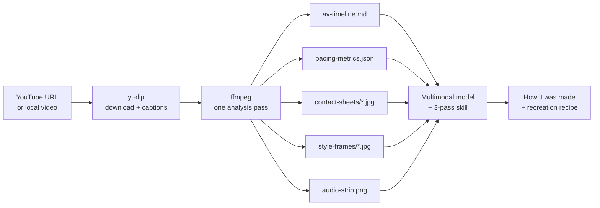
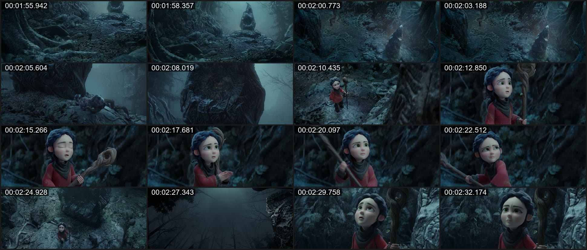
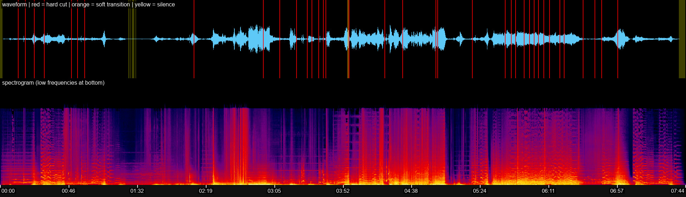

# video-deconstructor

**Reverse-engineer how any video is made, using the AI model you already have.**

Language models can't watch videos inside coding agents. `video-deconstructor` turns a YouTube URL or a local video into files a multimodal model *can* read: timestamped storyboard sheets, full-resolution style frames, an audio strip with cut markers, measured pacing statistics and a shot-by-shot A/V script. A bundled skill then guides the model through a three-pass breakdown of structure, visual design, and motion and transitions, ending in a recreation recipe.

It works as an **MCP server** (GitHub Copilot, Claude Desktop / Claude Code, Cursor, VS Code), a **CLI**, and an **agent skill**. It needs no API keys and has no npm dependencies, and it runs on Windows, macOS and Linux.



## What you get

| Artifact | What it shows |
| --- | --- |
| `contact-sheets/sheet_NNN.jpg` | 4x4 storyboard grids, each tile stamped with its exact timestamp. Shows motion, layout changes and pacing at a glance. |
| `style-frames/style_NN_<time>.jpg` | Native-resolution frames from representative shots, for typography, palette, textures and lighting. |
| `audio-strip.png` | Waveform + spectrogram on one time axis. Red = hard cut, orange = soft transition (dissolve/wipe), yellow = silence. |
| `av-timeline.md` | One row per shot: how it starts, start time, length, narration spoken during it, silences and its style frame. |
| `pacing-metrics.json` | Shot list, average/median shot length, cuts per minute, shot-length distribution, pacing per chapter, silences, narration-to-cut sync and per-second motion with suggested zoom windows. |
| `zoom/.../sheet_*.jpg` | High-fps (4-15 fps) sheets of a 2-10 s window, plus a per-frame motion curve, for reading easing, camera moves and transitions. |

Example (Vox, *The school-to-prison pipeline, explained*): the storyboard sheet shows the newspaper-clipping style with a highlighter reveal, then a cut to a data chart. The audio strip lines up 33 hard cuts and 2 diamond-wipe transitions against the narration.

## Quick start

### 1. Install the prerequisites

| | Windows | macOS | Linux (Debian/Ubuntu) |
| --- | --- | --- | --- |
| Node.js 18+ | `winget install OpenJS.NodeJS.LTS` | `brew install node` | `sudo apt install nodejs` |
| ffmpeg 4.4+ | `winget install Gyan.FFmpeg` | `brew install ffmpeg` | `sudo apt install ffmpeg` |
| yt-dlp (for URLs) | `winget install yt-dlp.yt-dlp` | `brew install yt-dlp` | `python3 -m pip install -U yt-dlp` |
| Deno (recommended for YouTube) | `winget install DenoLand.Deno` | `brew install deno` | `curl -fsSL https://deno.land/install.sh \| sh` |

yt-dlp needs a JavaScript runtime to download from YouTube. If Deno is not installed, `video-deconstructor` passes the Node.js it runs on to yt-dlp instead.

### 2. Get the code and check your setup

```bash
git clone https://github.com/shivam098/video-deconstructor.git
cd video-deconstructor
node bin/cli.mjs doctor
```

`doctor` runs every candidate binary, skips broken ones and tells you what's missing:

```text
video-deconstructor 0.1.0 on win32-arm64, Node v26.13.0
  OK   yt-dlp 2026.10.26  (...)
  OK   ffmpeg 9.0.2-full_build-www.gyan.dev  (...)
  OK   ffprobe 9.0.2-full_build-www.gyan.dev  (...)
  OK   ffmpeg filters
Ready.
```

### 3. Analyze a video

```bash
node bin/cli.mjs overview "https://www.youtube.com/watch?v=HoKkasEyDOI"
```

```text
The school-to-prison pipeline, explained - Vox
Range 00:00.000-03:16.023 | 1920x1080 @ 24 fps
Shots 36 (33 hard cuts, 2 soft transitions) | cuts/min 10.7 | avg shot 5.45s | median 2.25s | low-motion 9%
Captions: 80 lines (uploader subtitles) | silences: 2
Motion hotspots: 16-19s, 43-46s, 47-50s, 68-71s, 182-185s
Output: ./vd-output/youtube-HoKkasEyDOI
```

Then open the output folder in your agent and ask it to analyze the video, or connect the MCP server (below) and let it do everything.

## Use it from an AI agent

### As an MCP server

Add to your MCP client configuration. Use absolute paths.

**GitHub Copilot CLI / app** (`~/.copilot/mcp-config.json`):

```json
{
  "mcpServers": {
    "video-deconstructor": {
      "type": "local",
      "command": "node",
      "args": ["/absolute/path/to/video-deconstructor/bin/cli.mjs", "mcp"],
      "tools": ["*"]
    }
  }
}
```

**Claude Desktop** (`claude_desktop_config.json`), **Cursor** (`.cursor/mcp.json`) and **VS Code** (`.vscode/mcp.json`, key `servers` instead of `mcpServers`) use the same `command` / `args`.

**Claude Code:**

```bash
claude mcp add video-deconstructor -- node /absolute/path/to/video-deconstructor/bin/cli.mjs mcp
```

Tools:

| Tool | Purpose |
| --- | --- |
| `check_environment` | Verify yt-dlp / ffmpeg / ffprobe, with install hints. |
| `deconstruct_video_overview` | Passes 1-2: everything in "What you get" for a whole video or a `start`-`end` section. |
| `inspect_motion_or_transition` | Pass 3: high-fps sheets, motion curve and audio strip for a short window. |
| `extract_highres_style_frames` | Native-resolution frames at given timestamps. |

Every tool returns file paths. Agents that can open local files (Copilot, Claude Code, Cursor) view them directly. For clients that can't, such as Claude Desktop, pass `inline_images: N` to receive the first N images inline.

### As a skill

Copy or link `skills/video-production-deconstructor/` into your agent's skills folder (for example `~/.copilot/skills/` or `~/.claude/skills/`). Then ask things like:

> *Break down how this Kurzgesagt video was animated and give me a recipe to recreate the opening in After Effects: https://www.youtube.com/watch?v=fEjvSbI_PT4*

The skill tells the agent to run the overview, read the timeline and metrics, view the sheets and style frames, zoom into the motion hotspots, and report measured facts separately from inferences.

## CLI reference

```text
node bin/cli.mjs doctor
node bin/cli.mjs overview <url|file> [--start T] [--end T] [--fps N] [--max-sheets 12]
                          [--max-style-frames 12] [--threshold 0.3] [--soft-threshold 0.35]
                          [--grid 4x4] [--max-height 1080]
node bin/cli.mjs zoom     <url|file> --start T --end T [--fps 8] [--grid 4x4] [--tile-width 640] [--max-frames 96]
node bin/cli.mjs frames   <url|file> --timestamps T1,T2,... [--format jpg|png]
node bin/cli.mjs mcp
```

- Times: seconds (`75.5`), `MM:SS(.mmm)` or `HH:MM:SS`. All output timestamps are positions in the original video, even for section downloads.
- `--out DIR` sets the output folder (default `./vd-output/<video>`); `--json` prints the full result; `--captions FILE` supplies captions for a local file (otherwise a sidecar `name.vtt`/`name.srt` is used).
- Long videos: analyze a section with `--start`/`--end`, or keep the default, which caps the overview at 12 storyboard sheets by lowering the sampling rate.
- Downloads are cached per video, so `zoom` and `frames` after an `overview` don't download again.

Environment variables: `VD_FFMPEG`, `VD_FFPROBE`, `VD_YTDLP` (binary paths), `VD_CACHE_DIR`, `VD_OUTPUT_DIR`, `VD_FONT` (TrueType font for timestamps), `VD_JS_RUNTIME` (yt-dlp `--js-runtimes` value), `VD_QUIET`.

## Tested on

Six YouTube videos in different genres, analyzed end to end on Windows 11 ARM64. Full numbers and observations are in [docs/TEST-RESULTS.md](docs/TEST-RESULTS.md).

| Genre | Video | Shots | Cuts/min | Median shot | Notable |
| --- | --- | ---: | ---: | ---: | --- |
| Editorial explainer | Vox: *The school-to-prison pipeline, explained* | 36 | 10.7 | 2.25 s | Newspaper collage + highlighter, charts; 2 wipe transitions found |
| Business documentary | Bloomberg Originals: *Modi Promised to Clean the Ganges* (0:00-2:00) | 59 | 29.0 | 1.88 s | Fast cinematic B-roll intercut with interviews |
| 2D vector animation | Kurzgesagt: *What Happens When You Die?* (0:00-2:00) | 14 | 6.5 | 4.0 s | 6 of 13 cuts are soft (shaped wipes) |
| 3D animated short | Blender Studio: *Spring* | 39 | 4.9 | 6.08 s | Long atmospheric shots; cut density follows the score |
| Math animation | 3Blue1Brown: *But what is a neural network?* (0:00-2:00) | 1 | 0 | 120 s | One continuously morphing canvas, no cuts |
| Live action + maps | Johnny Harris: *The REAL reason the US can't beat Iran* (1:00-3:00) | 21 | 10.0 | 1.5 s | Paper-map montage into 3D terrain maps; 55 % of cuts land on narration |

Example output from *Spring* (© Blender Foundation, [CC BY 4.0](https://creativecommons.org/licenses/by/4.0/)): one storyboard sheet and the full-film audio strip.




## Development

```bash
npm test          # node --test: unit tests + synthetic-video pipeline tests + MCP protocol test
```

The pipeline tests generate a synthetic 5-second video with ffmpeg (a hard cut, a wipe, an audio gap and captions) and check every artifact. They are skipped automatically if ffmpeg is missing.

- [docs/ARCHITECTURE.md](docs/ARCHITECTURE.md): modules, analysis pipeline, ffmpeg recipes, output layout.
- [docs/HOW-IT-WAS-BUILT.md](docs/HOW-IT-WAS-BUILT.md): design decisions, problems found during testing and their fixes, limitations, ideas.
- [docs/TEST-RESULTS.md](docs/TEST-RESULTS.md): genre validation results.

## Troubleshooting

| Problem | Fix |
| --- | --- |
| Windows: `yt-dlp.exe - Bad Image ... 0xc0e90002` | Your device's Application Control policy blocks DLLs unpacked into `%TEMP%`. `video-deconstructor` already redirects yt-dlp's temp folder; if you run yt-dlp yourself, set `TMP`/`TEMP` to a folder outside `%TEMP%`, or `pip install yt-dlp`. |
| `doctor` shows `skipped ... exit 0xC0000005` | That ffmpeg build crashes on your machine and is ignored. Make sure another build is installed (Windows: `winget install Gyan.FFmpeg`), or set `VD_FFMPEG`. |
| `Sign in to confirm you're not a bot` / HTTP 403 from YouTube | Update yt-dlp (`yt-dlp -U`, `winget upgrade yt-dlp.yt-dlp`, `brew upgrade yt-dlp`), make sure Deno is installed, and retry later. |
| No timestamps on contact sheets / drawtext font error | Set `VD_FONT` to a `.ttf` file. |
| Section download is slow | Accurate section cuts re-encode the clip. For short videos, omit `--start`/`--end`. |
| Too many or too few cuts | Adjust `--threshold` (hard cuts) and `--soft-threshold` (dissolves/wipes; `0` disables). |

## Responsible use

This tool downloads media for personal analysis, study and critique. Respect copyright and the terms of service of the sites you download from. Don't redistribute downloaded videos or frames, and credit creators when you discuss their work.

## License

[MIT](LICENSE)
