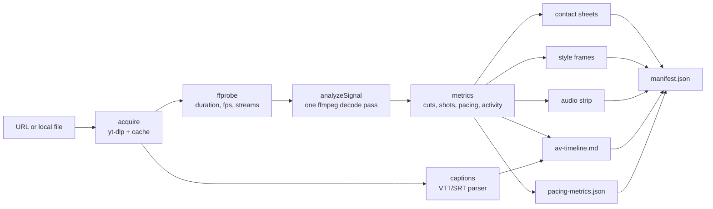

# Architecture

`video-deconstructor` is a small Node.js (>= 18) program with **no npm dependencies**. It shells out to three external tools and turns a video into files that a multimodal model can read.



## Modules

| File | Responsibility |
| --- | --- |
| `bin/cli.mjs` | Command-line entry point (`doctor`, `overview`, `zoom`, `frames`, `mcp`). |
| `src/mcp-server.mjs` | MCP server: newline-delimited JSON-RPC 2.0 over stdio, four tools. |
| `src/engine.mjs` | Pipelines (`overview`, `zoom`, `frames`), media acquisition and caching, ffmpeg rendering. |
| `src/binaries.mjs` | Finds working `yt-dlp` / `ffmpeg` / `ffprobe` binaries, fonts and cache paths. |
| `src/metrics.mjs` | Pure functions: hard cuts, soft transitions, pacing statistics, visual activity, style-frame selection. |
| `src/timeline.mjs` | Pure functions: caption parsing (VTT/SRT, YouTube rolling captions) and the A/V timeline. |
| `src/transcribe.mjs` | Optional Whisper speech-to-text: model download, backend detection (ffmpeg `whisper` filter or `whisper-cli`), transcription. |
| `src/gemini.mjs` | Optional Gemini pass-through: Files API upload, Interactions API call, polling, response parsing. |
| `src/util.mjs` | Process runner, time parsing/formatting, ffmpeg filter escaping. |

## Pipeline details

### 1. Acquisition and caching (`engine.mjs`)

- **URLs** go through yt-dlp: one call for metadata (`--dump-single-json`), one for English captions (uploader subtitles preferred, auto-captions otherwise), one for the media. Format preference is H.264 + AAC up to `max_height` (default 1080p) so decoding stays fast.
- **Sections**: when `start`/`end` are given, only that range (plus 1 s padding) is downloaded with `--download-sections` and `--force-keyframes-at-cuts`, so long videos can be analyzed piecemeal.
- **Cache**: `<cache>/media/<extractor>-<id>/` holds `source.json`, captions and downloads. A later request reuses any download that covers the requested range. YouTube URLs map straight to their video ID. Other sites are looked up in `<cache>/media/url-index.json`, so repeated calls skip the metadata request too. Timestamps everywhere are **absolute** positions in the original video; section offsets are handled internally.
- **Local files** need no network. Captions are taken from `--captions` or a sidecar file with the same base name (`clip.mp4` + `clip.vtt`/`clip.srt`/`clip.en.vtt`).

### 2. Signal analysis: one decode pass (`analyzeSignal`)

```text
[0:v] scale=256 -> split -> scdet=threshold=100, metadata@fine=print          (every frame)
                         -> fps=4, scdet=threshold=100, metadata@coarse=print (frames 0.25 s apart)
[0:a] silencedetect=n=-35dB:d=0.35
```

`scdet` emits two values per frame:

- **MAFD**: mean absolute frame difference, in percent of full scale. It measures *how much changed*.
- **score**: `min(MAFD, |MAFD - previous MAFD|)`. It spikes only when the amount of change itself jumps, which is what a cut looks like; steady motion keeps it low. The tool converts it to the scale of ffmpeg's `select` `scene` value (`score x 2.56 / 100`, clipped to 1), so the thresholds below read on a 0-1 scale.

Uses:

- **Hard cuts**: per-frame score >= `scene_threshold` (0.3); cuts closer than 0.25 s are merged.
- **Soft transitions**: dissolves, wipes and whip pans change the image gradually, so consecutive frames differ little. On the coarse branch (frames 0.25 s apart), a score >= `soft_threshold` (0.35) with no hard cut nearby is recorded as a soft transition.
- **Visual activity**: mean coarse-branch **MAFD** per second, skipping samples that span a cut. Because the frames are a fixed 0.25 s apart, it doesn't depend on the video's frame rate. Units are MAFD % (roughly `<0.3` for a still image or thin elements on a plain background, `1-5` for moderate motion, `>10` for fast motion). `motionHotspots` are the busiest non-overlapping 3 s windows, suggested as Pass 3 targets. `lowMotionShare` is the fraction of seconds below 0.3.
- **Zoom motion curve**: per-frame MAFD and score at native frame rate, used for reading easing (a decaying MAFD is ease-out) and spotting flashes.
- **Silences**: periods quieter than -35 dBFS for at least 0.35 s, which catch music drops and pauses before reveals.

### 3. Metrics (`metrics.mjs`)

- Shots are the spans between consecutive cuts (hard or soft). Each shot records how it was entered.
- Pacing: average and median shot length, cuts per minute, a shot-length distribution (`<1.5 s`, `1.5-3.5 s`, `3.5-7 s`, `>=7 s` with runtime share), per-chapter pacing when the video has chapters (otherwise fixed segments), and the longest and shortest shots.
- `narrationSync`: the share of cuts within 0.5 s of a caption line starting. This is approximate because caption timing is coarse.

### 4. Rendering (`engine.mjs`)

| Artifact | ffmpeg recipe |
| --- | --- |
| Contact sheets | `fps=N, scale=W:-2, drawtext=%{pts:hms:OFFSET}, tile=4x4` (the timestamp offset makes labels absolute). Overview fps defaults to `min(1, 16 x max_sheets / duration)` with a floor of 0.02 fps. |
| Style frames | Input-seek (`-ss`) to the midpoint of evenly spread shots, one native-resolution frame each. When there are fewer shots than `max_style_frames`, extra frames are taken inside long shots, at least 4 s apart. |
| Audio strip | `asplit` -> `showwavespic` + `showspectrumpic`, plus a `color` source with `drawtext` tick labels, all stacked with `vstack`. Every cut is drawn: markers are merged per pixel column (red wins over orange) and overlapping silences are merged. Graphs over 8,000 characters are passed as a script file (`-/filter_complex` on ffmpeg 7+, `-filter_complex_script` before that) to stay under the Windows command-line limit. |
| Zoom | The same contact-sheet recipe at 4-15 fps over a short window, plus an audio strip and a per-frame motion curve (`zoom.json`). |

### 5. Outputs

```text
<run dir>/
  manifest.json          summary, metadata, every artifact path, suggested next steps
  av-timeline.md         one row per shot: entry type, time, length, narration, silences, style frame link
  pacing-metrics.json    shots, cuts, pacing, silences, narrationSync, visualActivity
  captions.json          parsed caption lines (if any)
  audio-strip.png        waveform + spectrogram + cut/silence markers + time ruler
  contact-sheets/        sheet_001.jpg ...
  style-frames/          style_01_<time>.jpg ...
  zoom/<start>_<end>_<fps>fps/   sheet_*.jpg, audio-strip.png, zoom.json
  frames/                frame_01_<time>.jpg ...
```

The CLI writes to `./vd-output/<key>` by default; the MCP server writes to `<cache>/runs/<key>`. Both honour `--out` / `output_dir` and `VD_OUTPUT_DIR`.

## Optional add-ons

### Whisper transcription (`transcribe.mjs`)

- **Backend:** ffmpeg's `whisper` filter (FFmpeg 8+ built with whisper.cpp) is preferred, because it adds no extra binary:
  `aformat=sample_rates=16000:channel_layouts=mono,whisper=model=...:language=...:queue=20:destination=out.srt:format=srt`.
  If GPU initialisation fails, it is retried with `use_gpu=false`. Otherwise the tool extracts a 16 kHz mono WAV and runs `whisper-cli -osrt`.
- **Models:** whisper.cpp GGML files from `huggingface.co/ggerganov/whisper.cpp`, downloaded to `<cache>/models/` by `setup-whisper`. Each file is checked for the GGML magic number. `VD_WHISPER_MODEL` points to a custom model.
- **When it runs:** `overview` with `transcribe=auto` (default) transcribes only if the analyzed range has no captions and a model is installed; `always` overrides existing captions; `never` disables it. Without a model, the manifest carries a `narrationNote` with the setup command.
- **Caching:** transcripts are stored as `<cache>/transcripts/<key>__<model>__<lang>__<range>.json` with absolute timestamps, so `zoom` reuses them for any overlapping window.

### Gemini pass-through (`gemini.mjs`)

- **Endpoint:** Gemini Interactions API, `POST /v1beta/interactions` with `input: [{type: "video", ...}, {type: "text", text: prompt}]`, authenticated with the `x-goog-api-key` header from `GEMINI_API_KEY`. The key is never logged or written to disk.
- **YouTube URLs** are passed as `{type: "video", uri}`. **Local files and other URLs** (downloaded via the normal cache first) are streamed to the resumable Files API (`/upload/v1beta/files`), which is polled until `ACTIVE`. Containers Gemini doesn't accept are converted to H.264 MP4 first.
- **Options:** `start`/`end`/`fps` become `processing: {type: "static", start_offset, end_offset, fps}`. `agentic` sets `processing: "agentic"` and runs the request with `background: true`, polling `GET /v1beta/interactions/{id}`.
- **Responses:** text is read from `output_text`, `steps[type=model_output]`, `outputs` or `candidates`, and saved as Markdown with the model, mode and prompt. Error messages explain 429 (quota) and bad keys.
- **Testing:** `VD_GEMINI_BASE_URL` redirects all calls; the test suite uses it to run against a local mock server.

## Binary resolution (`binaries.mjs`)

Every candidate binary is **executed** (`-version` / `--version`) before use, and the first one that works wins. This was added after real-world failures (see [HOW-IT-WAS-BUILT.md](HOW-IT-WAS-BUILT.md)): a crashing ARM64 nightly ffmpeg sat first on `PATH`, and yt-dlp was blocked by Windows Application Control.

Search order: `VD_FFMPEG` / `VD_FFPROBE` / `VD_YTDLP` environment variables, then `PATH`, then well-known locations (WinGet packages and links, Scoop, Chocolatey, Homebrew, `/usr/bin`, `~/.local/bin`), then `python -m yt_dlp` for yt-dlp. Rejected candidates and the reasons are reported by `doctor` / `check_environment`.

On Windows, yt-dlp runs with `TMP`/`TEMP` pointed at `<cache>/runtime-tmp`, because PyInstaller unpacks DLLs into `%TEMP%`, which many device policies block.

yt-dlp needs a JavaScript runtime to solve YouTube's player challenges. Deno is used if installed; otherwise the tool passes `--js-runtimes node:<current node>`. Override this with `VD_JS_RUNTIME`.

## MCP server

The server is a dependency-free implementation of the MCP stdio transport. It handles `initialize`, `ping`, `tools/list`, `tools/call` and ignores notifications. Tool errors are returned as `isError: true` results so the model can see and react to them; protocol errors use JSON-RPC error codes. Logs go to stderr only.

All tools accept `inline_images: N` to also return the first N images as base64 `image` content, for clients that cannot open local files.
