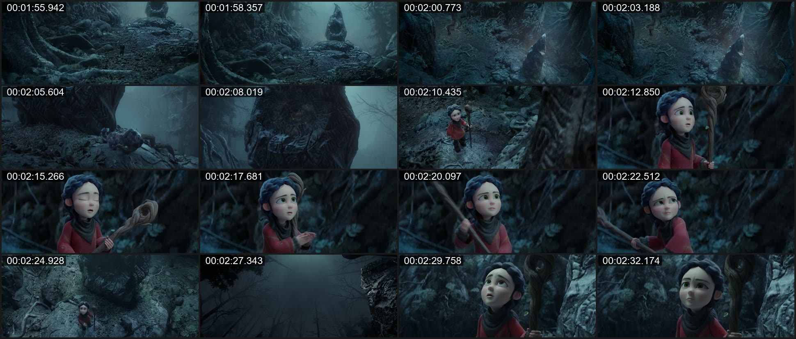
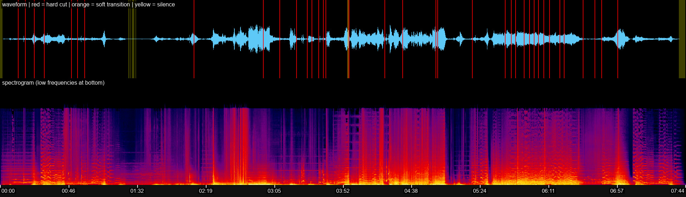

# Test results

All runs were on Windows 11 ARM64 (Snapdragon) with Node 26, ffmpeg 9.0.2 (Gyan, x64 under emulation), yt-dlp 2026.10.26 and Deno 2.9, using default settings (`scene_threshold` 0.3, `soft_threshold` 0.35, 12 sheets, 12 style frames). Every generated contact sheet, style frame and audio strip referenced below was opened and checked by eye.

## Automated tests

`npm test` runs 29 tests:

- **Unit (13):** time parsing/formatting, filter escaping, YouTube ID parsing, VTT (including YouTube rolling auto-captions) and SRT parsing, hard-cut detection and merging, soft-transition detection, pacing statistics, chapter segmentation, MAFD-based activity and hotspots, style-frame selection (many short shots and one long shot), and A/V timeline rendering.
- **Pipeline (4):** an ffmpeg-generated 5 s video with a hard cut at 2.0 s, a 0.5 s wipe at 3.0-3.5 s, an audio gap at 3-4 s and sidecar captions. The tests check that the overview finds exactly one hard and one soft cut at the right times, the silence, three style frames, the contact sheets, the audio strip and the narration-per-shot timeline. They also check that the zoom finds the cut in a 1 s window at 10 fps, that frames come out at native resolution, and that an audio strip with 700 cuts and 300 silences renders through a filter script file that is then cleaned up.
- **MCP (1):** starts the server over stdio and exercises `initialize`, `tools/list` (all seven tools), `tools/call` (`check_environment` including the Whisper/Gemini status, a failing call returned as `isError`, a real frame extraction with an inline image) and an unknown-method error.
- **Optional add-ons (11):**
  - **Whisper (5, real transcription):**
    - A 6 s clip with speech synthesized by ffmpeg's `flite` (starting at 1.5 s) and no captions. The overview transcribes it automatically and the timeline is labelled as a Whisper transcription.
    - A section transcription starting at 1 s returns absolute timestamps.
    - Model and output paths containing an apostrophe, a comma, spaces and brackets work.
    - A broken model doesn't abort an `auto` overview (it adds a note) but fails `always`.
    - `transcribe=never` disables transcription, a missing model produces the `setup-whisper` note, and `always` without a model fails clearly.
  - **Parsing (2):** repeated lines are kept with rolling de-duplication off, and four Gemini response shapes are read correctly.
  - **Gemini (4, against a local mock API):**
    - A YouTube link is sent directly with clipping and fps.
    - A local file is streamed through the resumable upload (headers, byte count) and polled until `ACTIVE`.
    - Agentic mode runs in the background and is polled; options that don't apply to it are rejected.
    - Error messages are clear for a 429 quota error, an invalid key and a missing key.

## Genre validation

Six YouTube videos covering different production styles. Times are positions in the original video.

| | Vox | Bloomberg Originals | Kurzgesagt | Blender Studio | 3Blue1Brown | Johnny Harris |
| --- | --- | --- | --- | --- | --- | --- |
| Video | *The school-to-prison pipeline, explained* | *Modi Promised to Clean the Ganges* | *What Happens When You Die?* | *Spring* (open movie) | *But what is a neural network?* | *The REAL reason the US can't beat Iran* |
| Genre | Editorial explainer | Business documentary | 2D vector animation | 3D animated short | Math animation (Manim) | Live action + maps |
| Range | full 0:00-3:16 | 0:00-2:00 | 0:00-2:00 | full 0:00-7:44 | 0:00-2:00 | 1:00-3:00 |
| Format | 1080p 24 fps | 1080p 23.976 | 1080p 60 | 1920x804 24 | 1080p 60 | 1080p 23.976 |
| Shots | 36 | 59 | 14 | 39 | 1 | 21 |
| Hard / soft cuts | 33 / 2 | 58 / 0 | 7 / 6 | 37 / 1 | 0 / 0 | 17 / 3 |
| Cuts per minute | 10.7 | 29.0 | 6.5 | 4.9 | 0 | 10.0 |
| Avg / median shot | 5.45 s / 2.25 s | 2.03 s / 1.88 s | 8.57 s / 4.0 s | 11.9 s / 6.08 s | 120 s / 120 s | 5.71 s / 1.5 s |
| Runtime in shots >= 7 s | 70 % | 7 % | 81 % | 83 % | 100 % | 72 % |
| Mean motion (MAFD %) | 4.10 | 3.95 | 3.49 | 2.31 | 0.25 | 2.50 |
| Low-motion seconds | 9 % | 2 % | 10 % | 8 % | 80 % | 7 % |
| Silences (>= 0.35 s) | 2 | 1 | 3 | 7 | 10 | 1 |
| Caption lines | 80 (uploader) | 41 (uploader) | 42 (uploader) | 1 (no dialogue) | 33 (uploader) | 53 (uploader) |
| Cuts within 0.5 s of a caption start | 37 % | 24 % | 31 % | - | - | 55 % |
| First run (download + analysis) | 92 s | 189 s | 274 s | 237 s | 101 s | 202 s |
| Re-run from cache | 37 s | 35 s | 40 s | 49 s | 33 s | 29 s |

First-run times include downloading. The 2-minute sections are slower because accurate section boundaries require a re-encode (see [HOW-IT-WAS-BUILT.md](HOW-IT-WAS-BUILT.md#5-known-limitations)).

### What the artifacts showed

These observations come from viewing the generated images, not from the numbers alone.

- **Vox.** The storyboard sheets show scanned newspaper clippings with a hand-drawn yellow highlight circle and line highlights, the camera drifting across the page, then a diamond-pattern wipe into a dark line chart (about 28.6-29.6 s). Before soft-transition detection was added, this wipe was missed; it is now one of the two soft transitions. Long held graphics (70 % of runtime in shots of 7 s or more) mix with bursts of very short shots (13 shots under 1.5 s).
- **Bloomberg Originals.** Cinematic B-roll of the river and ghats intercut with an interview. It has the fastest cutting of the set (median 1.88 s, 54 % of runtime in 1.5-3.5 s shots) and no soft transitions; everything is a straight cut. The audio strip shows a single silence of about 1 s near 0:51, inside an otherwise continuous bed of narration and music.
- **Kurzgesagt.** Flat vector characters on gradient backgrounds. Six of the 13 cuts are soft. The 10 fps zoom at 0:42.5-0:46 shows a chevron-shaped wipe sweeping right to left over a deep-purple panel while the character becomes an x-ray skeleton and collapses. The soft transition was detected at 44.1 s.
- **Spring (Blender Studio).** Long, atmospheric 3D shots (83 % of runtime in shots of 7 s or more) of a misty forest with volumetric fog and rim-lit characters. With no dialogue, the audio strip carries the structure: cut density rises with the louder passages of the score (about 3:00-4:00 and 5:30-6:30), and silences bracket the opening and the ending.
- **3Blue1Brown.** No cuts in two minutes. The whole section is one continuously transforming Manim canvas: logo, pixel grid, the pi creature and thought bubbles appearing and morphing on black. Low MAFD (80 % low-motion seconds) reflects thin strokes moving on a black background, not a frozen image. Style frames are therefore sampled every 10 s inside the single shot, and the 10 detected silences are narration pauses with no music bed.
- **Johnny Harris.** A section analyzed from 1:00, with absolute timestamps throughout. The sheets show a stack of physical paper maps being flipped quickly (hard cuts about a second apart), then a cut to a textured 3D terrain map with an animated country highlight and badge. It has the highest narration-to-cut alignment of the set (55 %).

### Pass 3 and frames via MCP

Run through the MCP server with real URLs, reusing the cache:

- `inspect_motion_or_transition` on the Kurzgesagt section, 0:42.5-0:46 at 10 fps: 8 s, 3 sheets (16 + 16 + 3 tiles), one soft transition at 44.125 s, two narration lines, one inline image.
- `extract_highres_style_frames` on `https://youtu.be/-DDbYSg0Alw` (short-URL form) at `1:17` and `01:24.5`: 4 s, two 1920x1080 frames taken from the cached 0:59-3:01 section.

### Other paths

- **Whisper on a real video:** `setup-whisper` downloaded `base.en` (141 MB) in 92 s. `transcribe` on the first 60 s of the Vox video took 5.4 s and produced 14 segments. Compared with Vox's own subtitles, the wording is close to verbatim and timestamps are within about 0.3 s. There was one error ("certain biases" where the subtitles say "certain violations"), and Whisper kept a sentence the subtitles condense.
- **Gemini:** only verified against the mock server, because no API key was available on the build machine. The live endpoint was reachable (it returned HTTP 403 without a key).

- **Non-YouTube URL:** `https://download.blender.org/peach/trailer/trailer_400p.ogg` (generic extractor, `.ogg` container). The overview found 18 shots, 30.9 cuts/min and a 1.1 s median shot (fast trailer cutting) in 6 s. A following `frames` call reused the cached download.
- **No Deno on PATH:** with `PATH` reduced to `C:\Windows`, the MCP server still found every binary in known install locations and fell back to `--js-runtimes node:<node>`. A fresh YouTube video (Vox, *Memory, Explained*) then downloaded and produced 1080p frames.

### Example output

Spring © Blender Foundation | studio.blender.org, licensed [CC BY 4.0](https://creativecommons.org/licenses/by/4.0/). Frames reproduced as analysis output.

Storyboard sheet 4 (1:55.9-2:32.2; tiles every 2.4 s because the overview of the 7:44 film is capped at 12 sheets):

Audio strip for the whole film. Red = hard cuts, orange = soft transition, yellow = silences:

